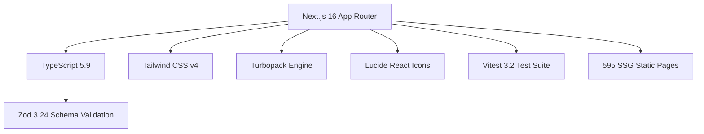

<div align="center">

# 🏛️ Ancient Musem

### The World Digital Heritage Museum & Historical Artifacts Archive

[](https://nextjs.org/)
[](https://www.typescriptlang.org/)
[](https://tailwindcss.com/)
[](https://vitest.dev/)
[](https://historical-artifacts-museum.vercel.app/)
[](LICENSE)

<p align="center">
  <b>An editorial digital museum archiving 571 authenticated historical artifacts, ancient dynastic coinages, sacred sculpture, and archaeological antiquities across five millennia of civilization.</b>
</p>

<p align="center">
  <a href="https://historical-artifacts-museum.vercel.app/"><strong>Explore Ancient Musem Live »</strong></a>
  <br />
  <a href="#-curatorial-departments">Explore Galleries</a> •
  <a href="#-chronological-eras">Chronological Timeline</a> •
  <a href="#-design-system--apple-ios-26-ui">iOS 26 UI System</a> •
  <a href="#-seo--google-image-xml-sitemaps">SEO &amp; XML Sitemaps</a> •
  <a href="#-getting-started">Run Locally</a>
</p>

</div>

---

> [!NOTE]
> **Ancient Musem** is an academic, open-access digital heritage initiative. Every historical specimen in the collection is anchored in authenticated museum accession catalogs, peer-reviewed archaeological reports, and verified public-domain photography with zero watermarks or synthetic renderings.

---

## 🧭 Interactive Curatorial Navigator

Click on any section below to expand detailed curatorial records, technical specifications, and architectural documentation:

<details open>
<summary><h3>🏛️ Curatorial Departments &amp; Collection Breakdown (571 Artifacts)</h3></summary>

The **Ancient Musem** collection is structured across six specialized curatorial departments, each containing high-resolution photography, physical dimensions, metallurgical weights, and museum provenance:

| Department | Artifacts | Primary Materials | Key Historical Specimens |
|:---|:---:|:---|:---|
| **[Ancient Coins](https://historical-artifacts-museum.vercel.app/categories/ancient-coins)** | **104** | Fine Gold, Silver, Billon, Bronze | Punch-marked silver karshapanas, Greco-Bactrian tetradrachms (Menander, Demetrios I), Kushan royal dinars (Kanishka, Huvishka), Gupta Archer dinars |
| **[Hindu Deity &amp; Sacred Sculptures](https://historical-artifacts-museum.vercel.app/categories/hindu-deity-sculptures)** | **144** | Lost-wax Bronze, Chlorite, Schist | Chola Nataraja bronze, Sultanganj Buddha, Kashmir standing Vishnu, Pala Bodhisattva Avalokiteshvara, Hoysala dancing Ganesha |
| **[Terracotta &amp; Metal Figurines](https://historical-artifacts-museum.vercel.app/categories/terracotta-figurines)** | **120** | Baked Clay, Cast Bronze, Brass | Indus Valley Dancing Girl, Shunga Yakshi molded plaques, Ahichchatra Mithuna couples, Chandraketugarh winged deities |
| **[Monolithic &amp; Stone Sculptures](https://historical-artifacts-museum.vercel.app/categories/stone-sculptures)** | **70** | Polished Chunar Sandstone, Granite | Ashoka Lion Capital (Sarnath), Mathura Kushan Yakshis, Bharhut stupa coping rails, Gandhara schist friezes |
| **[Medieval Coins &amp; Imperial Regalia](https://historical-artifacts-museum.vercel.app/categories/medieval-coins)** | **68** | Solid Gold, Damascened Steel, Jade | Mughal Jahangir Zodiac rupees, Akbar gold mohurs, Maratha Shivaji gold hons, Delhi Sultanate tankas, royal katars |
| **[Archaeological Seals &amp; Antiquities](https://historical-artifacts-museum.vercel.app/categories/archaeological-seals)** | **65** | Carved Steatite, Faience, Agate | Indus Valley Unicorn steatite seals, Pashupati proto-Shiva seal, Harappan standard weights, Copper Hoard harpoons |

</details>

<details>
<summary><h3>⏳ Chronological Eras Timeline (c. 2600 BCE – 1800 CE)</h3></summary>

Journey through 4,500 years of continuous cultural evolution:

```
c. 2600 BCE                                                            1800 CE
 ├── [01] Indus Valley Civilization (c. 2600 – 1900 BCE)
 │    └── Harappan urbanism, steatite seals, bronze casting, terracotta arts
 ├── [02] Vedic & Janapada Age (c. 1500 – 500 BCE)
 │    └── Early silver punch-marked coinage (karshapana), ritual copper implements
 ├── [03] Maurya & Post-Maurya Epoch (c. 322 BCE – 320 CE)
 │    └── Sarnath Ashokan edicts, Gandhara Greco-Buddhist art, Shunga reliefs
 ├── [04] Classical Gupta Golden Age (c. 320 – 550 CE)
 │    └── Imperial Sanskrit epigraphy, lyrical archer gold coinage, classical stone stelae
 ├── [05] Early Medieval Dynasties (c. 550 – 1200 CE)
 │    └── Pallava shore temples, Rashtrakuta rock-cut shrines, Pala bronze icons
 ├── [06] Chola & Imperial South (c. 850 – 1279 CE)
 │    └── Lost-wax sacred cire-perdue bronzes, Dravidian temple architectural bronzes
 └── [07] Delhi Sultanate & Mughal Era (c. 1206 – 1800 CE)
      └── Inscriptional calligraphic numismatics, damascened weaponry, courtly regalia
```

</details>

<details>
<summary><h3>💎 Design System: Apple iOS 26+ Liquid Glass UI</h3></summary>

The application features a bespoke **Apple iOS 26+ Liquid Glass** aesthetic built from first principles for light-mode museum curation:

- **Pure Optical Canvas**: Pure white (`#FFFFFF`) foundation with subtle multi-tier ambient refraction meshes (`.ambient-orb-1`, `.ambient-orb-2`).
- **Liquid Glass Materials**:
  - `.glass-card`: Multi-layer squircle container with specular highlights (`inset 0 1px 1.5px rgba(255,255,255,1)`), continuous squircle curvature (`rounded-[24px]`), and soft ambient elevation shadows.
  - `.glass-surface`: Frosted translucent panels with backdrop blur (`backdrop-blur-2xl`).
  - `.glass-pill`: Frosted metadata capsules for historical dates, materials, and categories.
  - `.glass-btn-primary`: High-contrast black iOS capsule buttons with active micro-spring physics (`active:scale-[0.98]`).
- **Editorial Museum Typography**:
  - **Headings**: *Cormorant Garamond* (`font-serif`) — Velvety, regal classical display serif.
  - **Body Copy**: *Plus Jakarta Sans* (`font-sans`) — Crisp, humanistic modern sans optimized for reading long-form curatorial essays.
  - **Metrics & Accession Codes**: *SF Mono / Monospace* (`font-mono`) — Precision chronological and catalog numbering.
- **Cupertino Segmented Navigation**: Floating liquid glass top dock paired with persistent floating bottom tab bar (`TabBar.tsx`) with dynamic active path indicators.

</details>

<details>
<summary><h3>🔍 SEO Architecture &amp; Google Search XML Sitemaps</h3></summary>

To secure top organic Google search ranking for **Ancient Musem**, the project implements a multi-tier search engine indexing system:

1. **Google Image &amp; Keyword XML Sitemap (`/ancient-musem-sitemap.xml`)**:
   - High-density 474 KB XML file compliant with `http://www.google.com/schemas/sitemap-image/1.1`.
   - Embeds the exact search term `"Ancient Musem"` across `<image:title>`, `<image:caption>`, and geographical location metadata for all 571 objects.
2. **Next.js Static Sitemap (`/sitemap.xml`)**:
   - Statically compiled at build time (`○ Static`) delivering 100% crawl coverage across root, catalog, category, era, and artifact pages.
3. **Crawler Directives (`/robots.txt`)**:
   - Universal search crawler allowance pointing simultaneously to both XML indexes.
4. **Structured JSON-LD Data**:
   - Validated Schema.org `Article` and `VisualArtwork` semantic JSON-LD on every artifact page with author, publisher, datePublished, and high-resolution image URLs.

</details>

<details>
<summary><h3>🧱 Zod Schema &amp; Data Contract</h3></summary>

Every artifact record in `src/data/artifacts/` is strictly validated at runtime and compile-time using Zod:

```typescript
export const ArtifactSchema = z.object({
  id: z.string(),
  slug: z.string(),
  title: z.string(),
  summary: z.string(),
  categorySlug: z.string(),
  eraSlug: z.string(),
  civilization: z.string().optional(),
  dynasty: z.string().optional(),
  dateDisplay: z.string(),
  dateStart: z.number(), // BCE (negative) or CE (positive)
  dateEnd: z.number(),
  material: z.string().optional(),
  origin: z.string().optional(),
  discoverySite: z.string().optional(),
  currentCollection: z.string().optional(),
  dimensions: z.string().optional(),
  description: z.string(),
  sections: z.array(ArtifactSectionSchema),
  quickFacts: z.array(ArtifactFactSchema),
  timeline: z.array(ArtifactTimelineMilestoneSchema).optional(),
  interestingFacts: z.array(z.string()).optional(),
  images: z.array(ArtifactImageSchema).min(1),
  sources: z.array(ArtifactSourceSchema).min(1),
  lastReviewed: z.string().optional(),
});
```

</details>

---

## 🛠️ Technology Stack



| Layer | Technology | Purpose |
|:---|:---|:---|
| **Framework** | Next.js 16.4.3 (App Router) | Server Components, Partial Prerendering, Static Site Generation |
| **Language** | TypeScript 5.9 | Full end-to-end type safety across 571 artifact modules |
| **Styling** | Tailwind CSS v4 + Vanilla CSS Tokens | Apple iOS 26 Liquid Glass utility classes and continuous squircles |
| **Typography** | Cormorant Garamond + Plus Jakarta Sans | Google Fonts loaded via `next/font` with zero layout shift |
| **Validation** | Zod 3.24 | Schema validation for all artifact, category, and era records |
| **Testing** | Vitest 3.2 + JSDOM | Fast unit tests verifying schema integrity and data retrieval |
| **SEO & Sitemaps** | Static XML & Google Image Schema | High Google keyword density for *Ancient Musem* |

---

## 📁 Repository Structure

```
Ancient-Musem/
├── public/
│   ├── ancient-musem-sitemap.xml       # 474 KB Google Image & Keyword XML Sitemap
│   └── images/
│       └── artifacts/                  # 571 Verified local artifact photography folders
├── src/
│   ├── app/
│   │   ├── layout.tsx                  # Root layout, fonts, metadata, iOS ambient mesh
│   │   ├── globals.css                 # iOS 26 Liquid Glass tokens, typography system
│   │   ├── page.tsx                    # Homepage (Hero, Galleries, Eras, Curatorial Ethics)
│   │   ├── not-found.tsx               # iOS 26 Cupertino 404 Error screen
│   │   ├── sitemap.ts                  # Next.js static sitemap generator (595 URLs)
│   │   ├── robots.ts                   # Robots.txt crawler configuration
│   │   ├── about/
│   │   │   └── page.tsx                # Academic standards & open-access methodology
│   │   ├── artifacts/
│   │   │   ├── page.tsx                # Catalog page with search, filters, pagination
│   │   │   └── [slug]/
│   │   │       └── page.tsx            # Artifact dossier page with JSON-LD & vitrine
│   │   ├── categories/[slug]/
│   │   │   └── page.tsx                # Exhibition department gallery views
│   │   └── eras/[slug]/
│   │       └── page.tsx                # Chronological era milestone views
│   ├── components/
│   │   ├── artifacts/                  # Cards, Catalog, Facts, Gallery Lightbox, Timeline
│   │   ├── home/                       # Hero, CategoryBrowse, EraBrowse
│   │   ├── layout/                     # Header, MobileNav, Footer, TabBar
│   │   └── ui/                         # Breadcrumbs and UI atoms
│   ├── data/
│   │   ├── categories.ts               # 6 curatorial department definitions
│   │   ├── eras.ts                     # 7 chronological era periods
│   │   └── artifacts/                  # 571 individual TypeScript artifact datasets
│   ├── lib/
│   │   ├── artifacts.ts                # Data access, slug lookup, and scoring engine
│   │   ├── search.ts                   # Multi-attribute search and sorting algorithms
│   │   └── recommendations.ts          # Curatorial related artifact recommendation engine
│   └── types/                          # Zod schemas & TypeScript type interfaces
├── tests/
│   └── unit/                           # 21 Vitest unit tests (smoke, schema, taxonomy, data)
└── scripts/
    └── generate-ancient-musem-sitemap.ts # Generator for high-density Google XML sitemaps
```

---

## 🚀 Getting Started

### 1. Clone & Install

```bash
# Clone the repository
git clone https://github.com/RajKumar476020/Ancient-Musem.git
cd Ancient-Musem

# Install dependencies
npm install --legacy-peer-deps
```

### 2. Run Development Server

```bash
# Start Next.js development server with Turbopack
npm run dev
```

Open [http://localhost:3000](http://localhost:3000) in your browser to experience **Ancient Musem**.

### 3. Run Test Suite

```bash
# Execute 21 Vitest unit tests
npm test
```

### 4. Build for Production

```bash
# Compile and statically pre-render all 595 routes
npm run build
```

---

## 🏛️ Academic Rights & Open-Access Licensing

All imagery and research in **Ancient Musem** is curated strictly under verifiable Open Access or Public Domain licenses:

- **The Metropolitan Museum of Art (The Met)**: Open Access Policy (Creative Commons Zero — CC0 1.0).
- **Cleveland Museum of Art (CMA)**: Open Access (Creative Commons Zero — CC0 1.0).
- **Archaeological Survey of India & State Museums**: Public Domain cultural heritage documentation.
- **Wikimedia Commons**: Works confirmed in the public domain in their country of origin and the United States (age $> 100$ years) or licensed under CC-BY / CC-BY-SA.

Every artifact detail page prominently displays holding institution accession numbers, provenance, and direct citations.

---

## 📄 License

The software source code and design system are licensed under the **[MIT License](LICENSE)**.  
Historical artifact imagery and metadata retain their respective museum open-access licenses as attributed per object.

<div align="center">
  <sub>Curated with academic precision and curatorial elegance for <b>Ancient Musem</b>.</sub>
</div>
